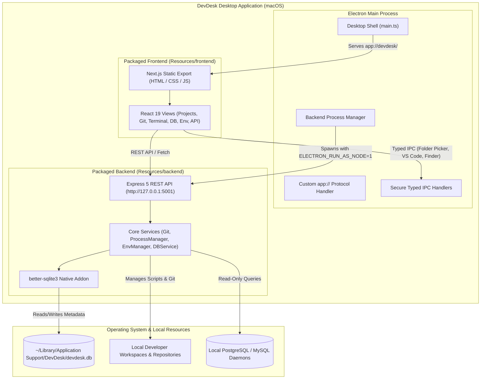

# DevDesk 🖥️⚡

> **The Native Desktop Command Center for Software Engineers.**  
> Effortlessly orchestrate workspaces, run project scripts with live logs, monitor processes and listening ports, manage Git repositories, test HTTP APIs, safely edit environment files, and query relational databases — all inside a single, high-performance desktop application.

---

## Table of Contents

- [Overview](#overview)
- [Key Features](#key-features)
- [Technology Stack](#technology-stack)
- [System Architecture](#system-architecture)
- [Repository Structure](#repository-structure)
- [Prerequisites](#prerequisites)
- [Development Setup](#development-setup)
- [Running in Development](#running-in-development)
- [Building the Production Package](#building-the-production-package)
- [Installation and Launch (macOS)](#installation-and-launch-macos)
- [macOS Gatekeeper & Unsigned Application Notice](#macos-gatekeeper--unsigned-application-notice)
- [Application Data & SQLite Storage](#application-data--sqlite-storage)
- [Security Model & Credential Policy](#security-model--credential-policy)
- [Troubleshooting & Port Conflicts](#troubleshooting--port-conflicts)
- [Platform Support & Verified Status](#platform-support--verified-status)
- [Release & Demonstration Guides](#release--demonstration-guides)
- [Screenshots](#screenshots)
- [License](#license)

---

## Overview

Modern software development requires juggling dozens of disparate tools: terminal windows, Postman/Insomnia, database GUIs, Git clients, process monitors, and text editors. **DevDesk** consolidates these critical developer workflows into a unified native desktop dashboard with zero cloud dependencies, instant local persistence, and rock-solid privacy.

Built with **Electron**, **Next.js**, **React**, **TypeScript**, **Express**, and **SQLite**, DevDesk runs entirely on your local machine, connecting to your local tools without shipping telemetry, tokens, or project code to external servers.

---

## Key Features

### 1. Workspace & Project Discovery
- **Native Directory Picker**: Select any folder on your Mac using standard native dialogs (`dialog:select-directory`).
- **Auto-Discovery**: Deep-scans directories to identify Node.js, Next.js, Express, Vite, and other projects along with package managers (`pnpm`, `npm`, `yarn`).
- **Quick Actions**: One-click **Open in VS Code** (`code <path>`) and **Reveal in Finder** (`showItemInFolder`).
- **SQLite Persistence**: Automatically remembers workspaces and project metadata across reboots.

### 2. Project Script Runner & Live Terminal
- **Script Inspection**: Reads `package.json` scripts and presents intuitive one-click launch controls.
- **Managed Execution**: Starts, stops, and restarts child processes with bounded, non-blocking standard I/O streaming.
- **Log Streaming**: Colorized, incremental stdout/stderr output with real-time status badges (`running`, `stopped`, `failed`).

### 3. Process & TCP Port Manager
- **Port Detection**: Detects actual TCP listening ports bound by DevDesk-managed services in real time using non-blocking OS inspection (`lsof`).
- **Zero Foreign Process Interference**: Strictly reports and controls processes started by DevDesk, protecting unrelated system services from accidental disruption.
- **Lifecycle Safety**: Cleanly terminates background processes and releases allocated ports when DevDesk closes.

### 4. Git Integration
- **Repository Inspection**: Branch status, tracking info, ahead/behind counters, and uncommitted change summaries.
- **Interactive Staging**: Stage and unstage individual files or entire trees with support for unborn branches (empty repos).
- **Commit Workflow**: Commit directly from DevDesk with safety validation preventing empty messages or staging anomalies.
- **Unified Diff Viewer**: Side-by-side / unified diff inspection with line additions and deletions.
- **Branch Switching**: Safe checkout safeguards preventing branch changes when uncommitted changes would conflict.

### 5. HTTP API Tester
- **Full Method Support**: `GET`, `POST`, `PUT`, `PATCH`, `DELETE`, `HEAD`, `OPTIONS`.
- **Query & Header Editor**: Key-value table builders with instant URL sync and custom header injection.
- **JSON Body Editor**: Real-time syntax validation, formatting error notifications, and payload size safeguards.
- **Response Inspector**: Formatted JSON viewer, raw text viewer, header tables, response timing (ms), and size metrics.
- **Cancellation & Timeouts**: Cancel in-flight HTTP requests instantly with configurable timeout bounds (default 30s) and a 2 MB response truncation guard.

### 6. Environment Variables Manager
- **Multi-File Detection**: Automatically lists `.env`, `.env.local`, `.env.development`, `.env.test`, `.env.production`, and `.env.example`.
- **Secret Masking**: Sensitive variables (tokens, passwords, secret keys) are masked by default with single-click visibility toggles.
- **Format Preservation**: Preserves original comments, section spacing, double quotes, and inline annotations.
- **Safety Backups & Atomic Writes**: Automatically creates timestamped `.bak` files before saving and uses atomic file replacement to eliminate data loss or partial writes.
- **Symlink & Path Traversal Guards**: Strict allowlist preventing symlink escapes or directory traversal outside the project root.

### 7. PostgreSQL & MySQL Database Manager
- **Multi-Engine Support**: Native connection support for both PostgreSQL and MySQL.
- **Schema & Table Browser**: Browse schemas, tables, and views with column metadata (primary keys, nullable fields, data types).
- **Read-Only SQL Execution Guard**: Proprietary AST parser and regex validator that blocks destructive statements (`INSERT`, `UPDATE`, `DELETE`, `DROP`, `ALTER`, `TRUNCATE`, `GRANT`, `REVOKE`, file outputs, and multi-statement injection).
- **Table Data Previews**: Rapid pagination previews with configurable row limits (default 50).
- **Zero Password Persistence**: Database credentials are strictly stored in volatile memory for active sessions—passwords are **never** written to SQLite or disk.

### 8. System Diagnostics & Keyboard Shortcuts
- **Live Diagnostics**: Health checks, memory usage, uptime, Node version, Electron version, active processes, and data paths.
- **Universal Shortcuts**: Navigate between views instantly (`Cmd+1` through `Cmd+8`), rescan workspaces (`Cmd+R`), open folders (`Cmd+O`), or trigger diagnostics (`Cmd+D`).

---

## Technology Stack

| Layer | Technologies |
| :--- | :--- |
| **Desktop Shell** | Electron 44.4.4, Node.js 24 (bundled) |
| **Frontend Framework** | Next.js 16.3.8 (Static HTML/JS Export), React 19.2.8 |
| **Language & Typing** | TypeScript 5.9.3 |
| **Styling & Design** | TailwindCSS 4.3.3, Custom Dark Mode Design System |
| **Local API Server** | Express 5.2.1 (bound strictly to `127.0.0.1:5001`) |
| **Local Database** | SQLite 3 via `better-sqlite3` 11.8.1 (Native C++ Addon) |
| **Database Drivers** | `pg` 8.23.1 (PostgreSQL), `mysql2` 3.24.6 (MySQL) |
| **SQL AST Parser** | `node-sql-parser` 5.4.0 |
| **Package Manager** | `pnpm` 11.24.0 (Monorepo Workspaces) |
| **Packaging & Distribution**| `electron-builder` 26.15.3 (macOS DMG & ZIP) |

---

## System Architecture



---

## Repository Structure

```text
DevDesk/
├── backend/                   # Local Express REST API service
│   ├── src/
│   │   ├── config/            # SQLite database & data dir configuration
│   │   ├── controllers/       # Route request handlers
│   │   ├── routes/            # REST API endpoint definitions
│   │   ├── services/          # Business logic (git, processes, env, database, api-tester)
│   │   └── index.ts           # Express server entry point (bound to 127.0.0.1:5001)
│   ├── package.json
│   └── tsconfig.json
├── desktop/                   # Electron desktop shell
│   ├── build-resources/       # Multi-resolution icon.icns & packaging assets
│   ├── scripts/               # Packaging after-pack hooks (after-pack.cjs)
│   ├── src/
│   │   ├── main.ts            # Electron main process, app:// protocol & backend runner
│   │   ├── preload.ts         # Secure, context-isolated typed IPC bridge
│   │   └── types.ts           # Desktop IPC type definitions
│   ├── electron-builder.yml   # electron-builder macOS DMG/ZIP configuration
│   ├── package.json
│   └── tsconfig.json
├── frontend/                  # Next.js 16 + React 19 desktop user interface
│   ├── src/
│   │   ├── app/               # Next.js App Router entry & layouts
│   │   ├── components/        # View components (Projects, Git, Terminal, Processes, etc.)
│   │   └── services/          # Frontend API client services
│   ├── next.config.ts         # Static export configuration (output: "export")
│   ├── package.json
│   └── tsconfig.json
├── release/                   # Generated macOS distribution outputs (DMG, ZIP, .app)
├── scripts/
│   └── prepare-packaging.mjs  # Multi-package build orchestrator
├── pnpm-workspace.yaml        # Monorepo workspace configuration
├── package.json               # Root scripts & orchestrations
└── README.md                  # Project documentation
```

---

## Prerequisites

- **Operating System**: macOS 13.0 (Ventura) or newer (Apple Silicon `arm64` tested).
- **Node.js**: `v20.17.0` or newer (`v22.13.0` recommended).
- **Package Manager**: `pnpm` `v11.0.0` or newer (`npm install -g pnpm@11.24.0`).
- **Development Tools** (Optional):
  - Visual Studio Code (for "Open in VS Code" project action).
  - Git CLI (`git` available in PATH).
  - PostgreSQL daemon (if testing live Database Manager connections).

---

## Development Setup

1. **Clone the repository**:
   ```bash
   git clone https://github.com/your-username/DevDesk.git
   cd DevDesk
   ```

2. **Install all workspace dependencies**:
   ```bash
   pnpm install
   ```

3. **Verify TypeScript compilation**:
   ```bash
   pnpm run build
   ```

---

## Running in Development

Run all three tiers (Frontend dev server, Express backend, and Electron desktop shell) concurrently:

```bash
pnpm run dev
```

Alternatively, start individual tiers in dedicated terminals:

```bash
# Terminal 1: Backend service (http://127.0.0.1:5001 with hot reload)
pnpm run dev:backend

# Terminal 2: Frontend dev server (http://localhost:3000)
pnpm run dev:frontend

# Terminal 3: Electron desktop shell
pnpm run dev:desktop
```

---

## Building the Production Package

To produce an installable macOS application and disk image (`.dmg`), run the automated packaging pipeline:

```bash
pnpm run package:mac
```

This single command automatically:
1. Verifies and syncs workspace dependencies.
2. Compiles Next.js into a standalone static export in `frontend/out`.
3. Compiles Express backend TypeScript into `backend/dist`.
4. Compiles Electron main and preload TypeScript into `desktop/dist`.
5. Deploys an isolated standalone production backend bundle with native modules.
6. Verifies multi-resolution Apple Icon (`desktop/build-resources/icon.icns`).
7. Bundles the final macOS DMG and ZIP archives into the `release/` directory.

### Build Outputs
- **macOS DMG Installer**: `release/DevDesk-1.0.0-arm64.dmg` (~138 MB)
- **macOS ZIP Archive**: `release/DevDesk-1.0.0-arm64-mac.zip` (~140 MB)
- **Standalone App Bundle**: `release/mac-arm64/DevDesk.app`

---

## Installation and Launch (macOS)

1. **Open the Disk Image**:
   Double-click `DevDesk-1.0.0-arm64.dmg` or run:
   ```bash
   open release/DevDesk-1.0.0-arm64.dmg
   ```
2. **Install to Applications**:
   Drag the **DevDesk** icon into the **Applications** folder link.
3. **Launch DevDesk**:
   Launch **DevDesk** from macOS Launchpad, Spotlight, or the Applications folder.

---

## macOS Gatekeeper & Unsigned Application Notice

Because this is a locally built developer release that has not been submitted to Apple's commercial Notary service with a paid Apple Developer certificate, macOS Gatekeeper may show a security notice on first launch:

> *"DevDesk.app cannot be opened because the developer cannot be verified."*

### How to Safely Allow First Launch

You can open the application using either of the following standard macOS developer methods:

#### Method A: Finder Right-Click (GUI)
1. Open your **Applications** folder in Finder.
2. **Right-click** (or `Control`-click) on **DevDesk.app**.
3. Select **Open** from the context menu.
4. In the dialog that appears, click **Open**. macOS will remember your approval for future launches.

#### Method B: Terminal Attribute Clear (CLI)
Remove the quarantine flag set by macOS on downloaded or unpacked bundles:
```bash
xattr -cr /Applications/DevDesk.app
```
Then launch DevDesk normally.

---

## Application Data & SQLite Storage

DevDesk stores persistent user data **strictly outside** the application bundle and outside `app.asar`, ensuring data survives application updates and reinstallations.

- **macOS Location**:
  ```text
  ~/Library/Application Support/DevDesk/devdesk.db
  ```
- **Tables**:
  - `workspaces`: Registered workspace root folders, project scan timestamps, and metadata.
  - `projects`: Discovered projects, project types, and package managers.
  - `database_connections`: Database connection profiles (host, port, username, database name, engine type).

---

## Security Model & Credential Policy

DevDesk follows a strict defense-in-depth local security architecture:

1. **Zero Database Passwords in SQLite**:
   - Database connection passwords are **never written to disk or SQLite**.
   - Passwords exist solely in volatile memory within the local Express process for active pool connections.
   - Closing DevDesk or disconnecting completely clears credentials from memory.
2. **Loopback Only (`127.0.0.1`)**:
   - The Express API server binds strictly to `127.0.0.1`. It does not listen on `0.0.0.0` or broadcast to local networks.
3. **Electron Isolation**:
   - `contextIsolation: true`
   - `nodeIntegration: false`
   - `sandbox: true`
   - Preload exposes only tightly scoped, typed IPC handlers (`selectDirectory`, `openInVSCode`, `revealInFinder`).
4. **Read-Only Database Enforcement**:
   - SQL queries executed through the Database Manager are parsed and validated via AST analysis to block all write/mutate/DDL commands (`INSERT`, `UPDATE`, `DELETE`, `DROP`, `ALTER`, `GRANT`, `REVOKE`, file dumps, and multi-statement queries).
5. **Environment File Protection**:
   - Symlinks resolving outside project roots are rejected.
   - Path traversal attempts (`../`) are blocked.
   - Atomic replacement prevents file corruption.

---

## Troubleshooting & Port Conflicts

### Backend Port 5001 Already in Use
DevDesk requires port `5001` for its internal loopback API. If another application occupies port 5001:
- DevDesk **does not** kill the unrelated application.
- DevDesk displays an informative error card:
  > *"Port 5001 is already in use by another application on your Mac."*
- **Resolution**:
  Identify and terminate the process holding port 5001:
  ```bash
  lsof -i :5001
  kill -9 <PID>
  ```
  Then click **Retry Startup** in DevDesk.

### Visual Studio Code Command Not Found
- Ensure `code` is installed in your terminal PATH:
  In VS Code, open the Command Palette (`Cmd+Shift+P`) and run:
  `Shell Command: Install 'code' command in PATH`.

### Resetting Corrupted Application Data
If your local database ever needs a fresh start:
```bash
# Backup existing database
mv ~/Library/Application\ Support/DevDesk/devdesk.db ~/Desktop/devdesk.db.backup
```
DevDesk will automatically initialize a fresh SQLite database on next launch.

---

## Platform Support & Verified Status

| Feature / Platform | Status | Verification Details |
| :--- | :---: | :--- |
| **macOS Apple Silicon (`arm64`)** | **Verified** | Fully packaged and tested on Apple Silicon (M-series). |
| **macOS Intel (`x64`)** | **Planned** | Requires compilation on x64 host or cross-compiled native modules. |
| **PostgreSQL Database Manager** | **Verified** | Tested with local and ephemeral PostgreSQL clusters. |
| **MySQL Database Manager** | **Unverified Live** | Full driver & parser integration ready; live connection unverified due to lack of local MySQL test daemon. |
| **Git Integration** | **Verified** | Status, diffs, branch checkout, staging, and commits verified. |
| **API Tester** | **Verified** | All HTTP methods, query params, timeouts, and cancellations verified. |
| **Env Variables Manager** | **Verified** | Comment preservation, atomic writes, backups, and masking verified. |

---

## Release & Demonstration Guides

For comprehensive release engineering, live demo workflows, and quality assurance checklists, explore the project documentation:

- 🎬 [**5–7 Minute Product Demonstration Plan**](docs/DEMO_SCRIPT.md): Live presentation walkthrough covering workspace discovery, script execution, port detection, Git diffs, API testing, safe environment variable edits, and read-only database queries.
- 📋 [**Pre-Release Verification Checklist**](docs/RELEASE_CHECKLIST.md): Quality assurance criteria, artifact checksums, clean-install verification, and security checklists.
- 🚀 [**GitHub v1.0.0 Release Notes**](docs/GITHUB_RELEASE.md): Distribution package summaries, SHA-256 hashes, Gatekeeper approval instructions, and release highlights.
- 📸 [**Screenshot Capture Guide**](docs/SCREENSHOT_GUIDE.md): Guidelines and checklists for capturing visual assets across all major views.
- 📜 [**Changelog**](CHANGELOG.md): Chronological history of completed modules and features.

---

## Screenshots

> *Screenshots captured from DevDesk v1.0.0 on macOS.*

### 1. Projects & Workspaces View
*Scan local directories, view discovered projects, run scripts, or open in VS Code.*
```
+---------------------------------------------------------------------------------------+
|  DevDesk          [ Workspaces ]  [ Terminal ]  [ Git ]  [ API ]  [ Env ]  [ DB ]     |
+---------------------------------------------------------------------------------------+
|  Saved Workspaces: /Projects/WebApps                                                  |
|  +--------------------+  +--------------------+  +--------------------+               |
|  | Frontend App       |  | Backend API        |  | Analytics Service  |               |
|  | Next.js • pnpm     |  | Express • Node.js  |  | Python • FastAPI   |               |
|  | [Open in VS Code]  |  | [Open in VS Code]  |  | [Open in VS Code]  |               |
|  +--------------------+  +--------------------+  +--------------------+               |
+---------------------------------------------------------------------------------------+
```

### 2. Live Terminal & Script Runner
*Real-time log streaming with process start, stop, and restart controls.*

### 3. Database Manager & Read-Only Query Explorer
*Inspect tables, view column schemas, and execute read-only queries with SQL safety enforcement.*

---

## License

This project is licensed under the [ISC License](LICENSE).