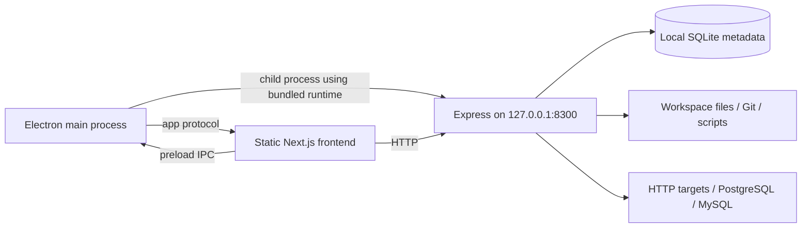

# DevDesk architecture

DevDesk 1.0.2 is a pnpm workspace with an Electron desktop shell, a statically
exported Next.js frontend, and an Express API backed by SQLite.

## Runtime



In development, Next.js serves port 8200 and the synced backend uses port 8300.
The Electron shell connects to that server without spawning a production backend.
Source configuration can target a hosted backend. See `frontend/src/config/env.ts`.

In the packaged app, Electron serves `Resources/frontend` via `app://devdesk/`.
It starts `Resources/backend/dist/index.js` using its own executable with
`ELECTRON_RUN_AS_NODE=1`, so a separate Node installation is unnecessary. It waits
for `/health` before loading the main screen. The local test installer compiles
its frontend for `127.0.0.1:8300`; packaged startup ignores working-directory `.env`
files. It reclaims that port before starting a fresh bundled backend: listeners receive
SIGTERM, then SIGKILL if they do not stop. Recovery verifies the port is free and
protects DevDesk and its launcher ancestors. Permission failures or a continuously
restarting listener can still prevent startup. There is no dynamic port fallback.

## Desktop bridge

`desktop/src/main.ts` owns the window, protocol handler, backend lifecycle, and
native integrations. `desktop/src/preload.ts` exposes the typed bridge for folder
selection, editor launching, Finder, and other native actions. Renderer settings
include context isolation, disabled Node integration, and sandboxing. New bridge
methods need matching types, main handlers, and preload methods.

## Backend responsibilities

Routes and controllers dispatch to services for workspace scanning, process
management, Git, HTTP requests, environment editing, and database access.
Managed script logs are held in bounded memory buffers (2,500 lines per process).
The port inspector uses OS commands; Git operations depend on the host Git CLI
and its authentication setup. Package scripts depend on host developer tools.

The SQL service uses `node-sql-parser` to validate read-oriented queries. Treat this
as an application guard, not a substitute for a read-only database role. The env
editor masks sensitive fields in the UI and creates backups when writing files;
masking does not encrypt the underlying files.

## Persistence

`backend/src/config/database.ts` initializes the SQLite schema and incremental
migrations. Tables include `workspaces`, `projects`, and `database_connections`.
Connection profiles omit passwords; active passwords stay in process memory.
The default macOS database is:

```text
~/Library/Application Support/DevDesk/devdesk.db
```

The backend accepts a `DEVDESK_DATA_DIR` override. SQLite enables foreign keys and
WAL mode. The driver first tries `better-sqlite3`, then falls back to the bundled
runtime's `node:sqlite` when the native addon is unavailable or ABI-incompatible.
Packaging intentionally avoids copying a native addon built for host Node.

## Boundaries and limitations

The API normally binds to loopback, but the source accepts `HOST` overrides.
It has permissive CORS and no API authentication. Local software and untrusted
browser content are relevant threats; this is a developer testing build, not a
hardened public service. Scripts, remote Git operations, HTTP requests, web
previews, and database connections can access external systems. The app is
local-first, but it does not guarantee offline operation or zero network traffic.

The configured installer targets Apple Silicon macOS only. See the
[packaging guide](PACKAGING_AND_RELEASES.md) for artifact layout and verification.
